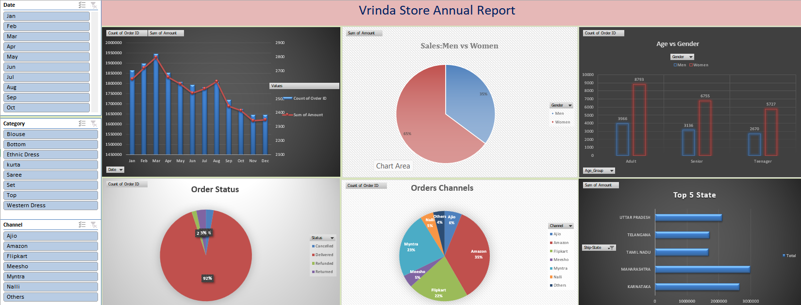

# Vrinda Store Annual Report – Excel Dashboard

## Project Overview
This project analyzes Vrinda Store's annual sales data using Microsoft Excel. The dashboard presents sales and order insights to help understand customer behavior, sales performance, and order distribution.

## Tools Used
- Microsoft Excel
- Pivot Tables
- Pivot Charts
- Data Analysis
- Interactive Dashboard

## Dataset Description
The dataset contains approximately 31,047 order records with information such as:
- Order ID and Customer ID
- Gender and Order Date
- Order Status and Sales Channel
- Product Category and Size
- Quantity and Sales Amount
- Shipping City and State

## Key Analysis
- Sales comparison between men and women
- Order distribution by sales channel
- Customer analysis by age group and gender
- Sales and order performance analysis
- Product and regional sales insights

## Dashboard Features
- Visual representation of sales and order data
- Summary of key business insights
- Charts for comparing customer and sales performance
- Excel-based dashboard for exploring sales trends

## Project Objective
The objective of this project is to analyze sales data, identify useful business insights, and present the findings through an Excel dashboard to support data-driven decision-making.

## Skills Demonstrated
- Excel Data Analysis
- Pivot Tables and Pivot Charts
- Data Visualization
- Business Insights
- Dashboard Development

## Conclusion
This project demonstrates how Microsoft Excel can be used to analyze retail sales data and transform raw data into meaningful business insights through an interactive dashboard.
## Dashboard Preview

